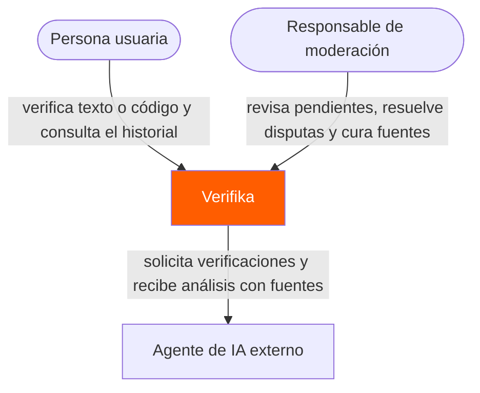
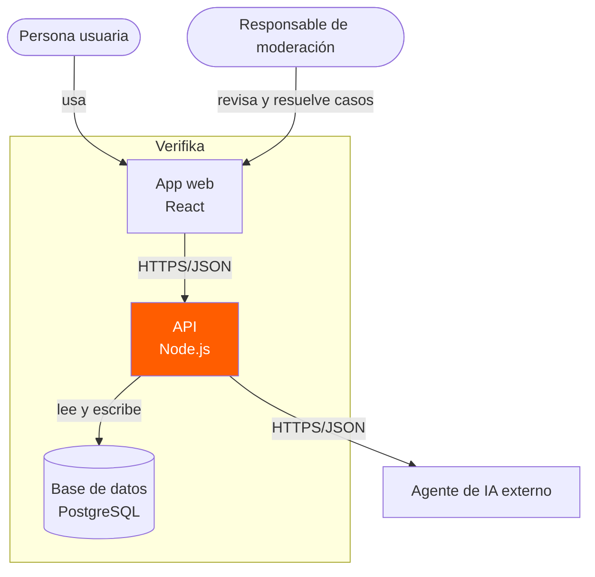
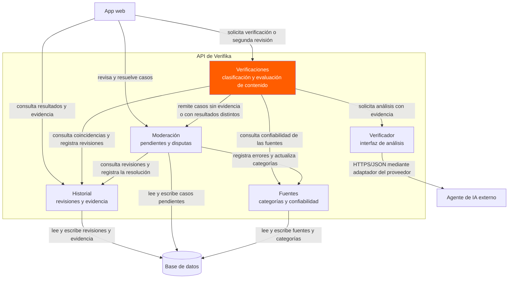

# Diagramas de arquitectura Verifika

## 1. Nivel 1 Diagrama de contexto

El sistema completo, quién lo usa y con quién habla.

## 2. Nivel 2 Diagrama de contenedores

Las piezas que se despliegan y se ejecutan por separado.

## 3. Nivel 3 Diagrama de componentes

Lo que hay dentro de un contenedor: la API de Verifika.

